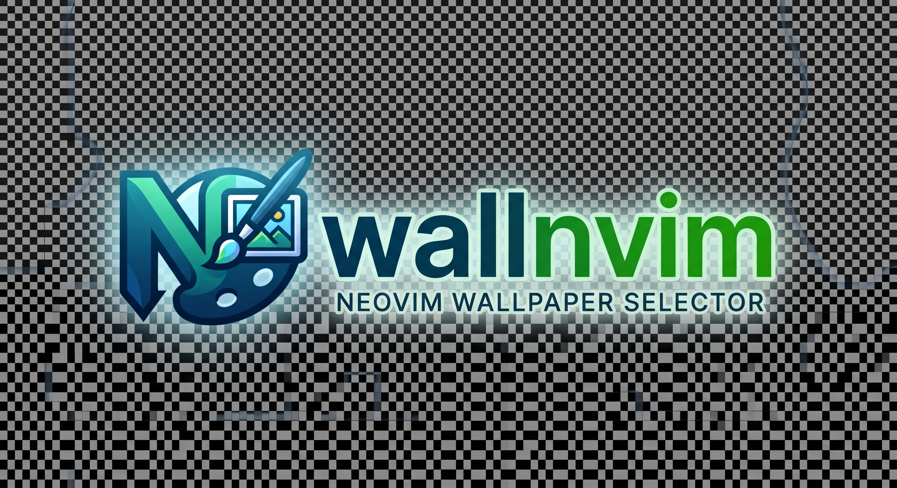

Seletor visual de wallpapers em janela flutuante pro Neovim. 

Suporte a **imagens** (com miniaturas) e **sem imagem** (modo lista). Tem dois layouts: `grid` e `list`/`text`. No `auto` detecta se o terminal suporta imagens via Kitty Graphics Protocol (Kitty, WezTerm, Ghostty, Konsole, tmux).


## Instalação

Use com [lazy.nvim](https://github.com/folke/lazy.nvim):

```lua
{
  "DaFi-1/wallnvim",
  config = function()
    require("wallnvim").setup({
      keymap = "<space>l",        -- Atalho para abrir
      dir = "~/Pictures/wallpapers", -- Pasta com seus wallpapers
      layout = "auto",            -- "grid" | "list" | "text" | "auto"
      cmd = "feh",                -- Comando para aplicar wallpaper
      cmd_args = { "--no-fehbg", "--bg-fill" },
      width = 110,
      height = 32,
      cell_width = 16,
      cell_height = 6,
      gap = 1,
      border = "rounded",
      preload = true,
    })
  end,
}
```

Pode mudar qualquer opção acima. Todas tem padrão, não precisa passar tudo.

**Requisitos:** Neovim >= 0.10.0, `feh`, `ffmpeg`, `sqlite3` ou `libsqlite3`  
**Formatos:** `.jpg`, `.jpeg`, `.png`, `.webp`, `.bmp`, `.gif`

## Comandos

| Comando | Ação |
| --- | --- |
| `:WallNvim` | Abrir seletor |
| `:WallToggle` | Abrir/fechar seletor |
| `:WallSet <caminho>` | Aplicar wallpaper direto pelo caminho |

## Teclas

| Tecla | Ação |
| --- | --- |
| `h/j/k/l` ou `←/↓/↑/→` | Navegar |
| `<Tab>` | Alternar entre grid/lista |
| `<CR>` | Aplicar wallpaper selecionado |
| `q` / `<Esc>` / `<C-c>` | Fechar |

## Licença

MIT License

Copyright (c) 2026 DaFi-1

Permission is hereby granted, free of charge, to any person obtaining a copy
of this software and associated documentation files (the "Software"), to deal
in the Software without restriction, including without limitation the rights
to use, copy, modify, merge, publish, distribute, sublicense, and/or sell
copies of the Software, and to permit persons to whom the Software is
furnished to do so, subject to the following conditions:

The above copyright notice and this permission notice shall be included in all
copies or substantial portions of the Software.

THE SOFTWARE IS PROVIDED "AS IS", WITHOUT WARRANTY OF ANY KIND, EXPRESS OR
IMPLIED, INCLUDING BUT NOT LIMITED TO THE WARRANTIES OF MERCHANTABILITY,
FITNESS FOR A PARTICULAR PURPOSE AND NONINFRINGEMENT. IN NO EVENT SHALL THE
AUTHORS OR COPYRIGHT HOLDERS BE LIABLE FOR ANY CLAIM, DAMAGES OR OTHER
LIABILITY, WHETHER IN AN ACTION OF CONTRACT, TORT OR OTHERWISE, ARISING FROM,
OUT OF OR IN CONNECTION WITH THE SOFTWARE OR THE USE OR OTHER DEALINGS IN THE
SOFTWARE.
